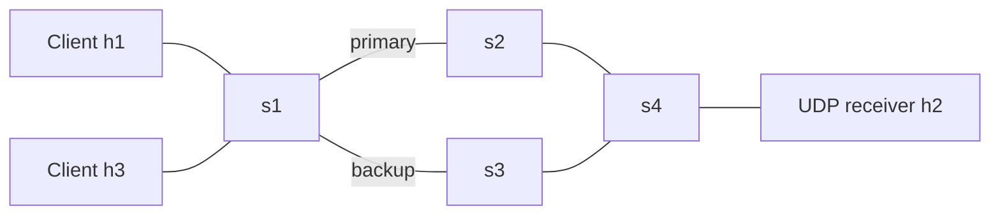

# Jackfruit: UDP packet-loss detection and SDN recovery

A reliable UDP application that reports repeated missing acknowledgments to an
OpenFlow 1.3 controller. The controller moves both directions of traffic from a
primary path to an independent backup path. Two concurrent clients share a
receiver. Static routing provides the comparison baseline.

**Verified:** 17 automated tests and 18 real Mininet experiments passed, including
an independent audit of backup forwarding and receiver delivery. See the
[measured results and raw evidence](docs/validation.md).

## Quick start

Use Ubuntu 22.04 in a VM or Linux host with Mininet-compatible kernel support.
The supplied installation guide's package-manager approach is used inside the
container. Docker shares the host kernel: installing packages alone cannot add
missing Open vSwitch, veth, HTB, or netem functionality to a restricted kernel.
On a supported native Ubuntu VM, load the modules before the Docker demo with
`sudo modprobe -a openvswitch veth sch_htb sch_netem`.

```sh
git clone https://github.com/DeevamJain/CN--SDN-mininet-Project.git
cd CN--SDN-mininet-Project
bash scripts/lab.sh build
bash scripts/lab.sh test
bash scripts/lab.sh demo dynamic normal results/normal-dynamic-1
bash scripts/lab.sh demo dynamic loss results/loss-dynamic-1
bash scripts/lab.sh demo dynamic link_failure results/link_failure-dynamic-1
```

Use a fresh output directory for each run. Lab containers are disposable and
results persist in the checkout. No public ports or host networking are needed.
The lab requires a privileged container to create isolated network namespaces.
Do not run simultaneous experiments in the same namespace. For a native Ubuntu
installation, run `bash scripts/setup-ubuntu.sh`, start Open vSwitch with
`sudo service openvswitch-switch start`, then use
`sudo .venv/bin/python -m jackfruit.experiment --mode dynamic --scenario loss --output results/native-loss`.

Full comparison: 3 scenarios × 2 policies × 3 trials, two clients per run:

```sh
bash scripts/lab.sh matrix results/comparison
# Generated: per-run JSON/logs, comparison/summary.csv, comparison/REPORT.md
# The matrix also audits forwarding paths and actual receiver outcomes.
```

The experiment tests initial connectivity, injects the fault after 0.8 seconds,
waits for the clients, captures controller events, flow tables, queue counters,
receiver delivery counts, and sender metrics, then cleans up the topology.
The static link-failure run is expected to exhaust retries for some packets.
A failed setup or crashed process is recorded with `valid: false` and excluded
from analysis. Incomplete delivery is retained as an experimental outcome.

## Architecture



See [the exact topology](docs/architecture.md) for ports and paths.
All data links are 10 Mbit/s with 5 ms one-way emulated delay per link.
Both paths exist concurrently. Exact MAC-destination rules and static ARP avoid
broadcast loops. Dedicated out-of-band management links deliver authenticated
loss events even while the data path is broken.

The default scenario applies 35% forward loss to `s2-eth2`. After eight
retransmissions, a client reports missing sequence numbers. In dynamic mode the
controller programs the backup route; in static mode it keeps the primary.
Link failures also trigger controller port-status handling and periodic port
monitoring. The backup remains selected until the next experiment; automatic
failback is deliberately excluded to avoid route oscillation.

## Application operation without Mininet

Python 3.10+ and the standard library are sufficient for socket development:

```sh
# Terminal 1
python3 -m jackfruit.receiver --host 127.0.0.1 --output receiver.json
# Terminal 2; start more terminals for concurrent clients
python3 -m jackfruit.sender --host 127.0.0.1 --output client.json
# Ctrl-C the receiver to flush its final report
python3 -m unittest discover -s tests -v
```

Without OS-Ken, controller tests are explicitly skipped; the Docker test command
installs OS-Ken and runs them. The application sends bounded synthetic payloads,
not files. Delivery means the receiver accepted each sequence number; it does
not mean durable application storage. UDP/IP checksums provide accidental
corruption detection. This is a controlled educational lab, not an encrypted
Internet-facing transfer service.

## Deliverables

| Requirement | Implementation / evidence |
|---|---|
| Low-level UDP, concurrency, framing | `jackfruit/protocol.py`, `sender.py`, `receiver.py` |
| Sequence tracking, ACKs, bounded retransmission | Selective-repeat sender and deduplicating receiver; socket tests |
| Mininet and alternate paths | `jackfruit/experiment.py` |
| SDN forwarding and monitoring | `jackfruit/controller.py`, OpenFlow rules, port statistics |
| Socket–SDN integration | Authenticated `POST /event`, pending sequence report, dynamic reroute |
| Challenging scenarios | Loss injection, primary link failure, absent receiver and malformed traffic tests |
| Baseline and evaluation | `scripts/matrix.sh`, `jackfruit/analyze.py`, raw per-run artifacts |
| Architecture, reproduction, viva | `docs/`, this README |

See [protocol and control API](docs/protocol.md), [evaluation methodology](docs/evaluation.md),
[demo and viva guide](docs/demo.md), and [validation status](docs/validation.md).
The repository includes the measured report and raw evidence for the completed
18-experiment comparison. Use fresh runs to evaluate changes.
