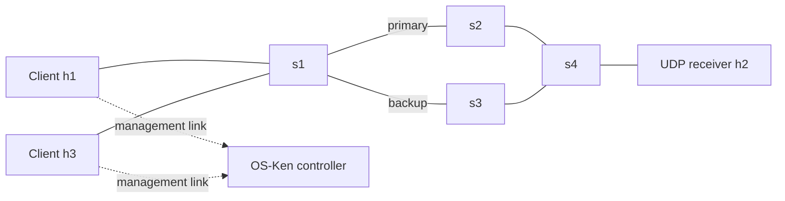
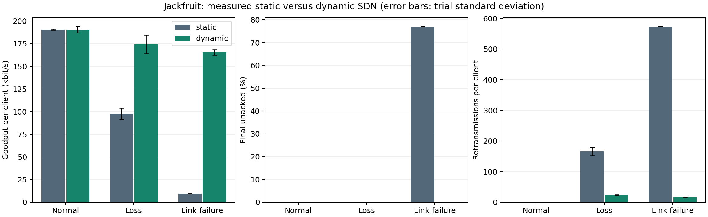

# Faculty presentation: UDP packet-loss detection and SDN recovery

Suggested duration: **12–15 minutes, including a short demo**.
Each numbered section is one slide. Use the bullet points on screen and the
expandable notes to rehearse your explanation. Replace the presenter details
on slide 1 before copying the content into PowerPoint or Google Slides.

## 1. Title

**UDP Packet Loss Detection and Recovery Using SDN**

Jackfruit Mini Project — Computer Networks

Presented by: **[Name, roll number, and team members]**

<details>
<summary>Speaker notes</summary>

The project combines reliable application communication over UDP with
programmable network control. The application retransmits missing packets,
and the SDN controller moves traffic away from an impaired primary path.

</details>

---

## 2. Problem statement

- UDP does not automatically provide ACKs, retransmission, or ordered delivery.
- Packets can be lost because of network impairment or a broken link.
- Repeatedly sending through the same faulty path can reduce goodput.
- We combine application reliability with network-path recovery.

<details>
<summary>Speaker notes</summary>

There are two problems to solve. First, recover packets that were not
acknowledged. Second, avoid continuing to use a problematic route. Application
retransmission solves the first problem; SDN rerouting addresses the second.

</details>

---

## 3. Objectives

1. Implement low-level UDP socket communication.
2. Support multiple concurrent clients.
3. Track sequences and recover unacknowledged packets.
4. Deploy primary and backup paths in Mininet.
5. Trigger dynamic rerouting through application and network events.
6. Measure recovery and compare static and dynamic routing.

<details>
<summary>Speaker notes</summary>

The project must demonstrate working sockets and meaningful SDN integration.
Both policies use the same reliable UDP application, allowing the experiments
to isolate the additional benefit of changing the route.

</details>

---

## 4. System architecture and topology



- Two clients, one receiver, four Open vSwitch switches, one SDN controller.
- Primary: `s1 → s2 → s4`; backup: `s1 → s3 → s4`.
- Each data link: **10 Mbit/s and 5 ms delay**.
- Dedicated management links carry loss reports outside the impaired path.

<details>
<summary>Speaker notes</summary>

Mininet creates virtual hosts and switches on Linux. Each host runs a real
Python process using real sockets. The controller programs all four switches
through OpenFlow 1.3. Static ARP and explicit destination forwarding rules
prevent broadcast loops. The diagram's dashed lines represent management,
not an additional data route through the controller.

</details>

Reference: [exact ports and addresses](architecture.md).

---

## 5. UDP protocol and sequence tracking

| Field | Purpose |
|---|---|
| Version | Identifies the protocol version |
| Transfer ID | Separates transfers from different clients |
| Sequence number | Identifies a packet within a transfer |
| Total packets | Specifies the expected number of unique packets |
| Payload | Carries synthetic test data |

```text
Received: 0, 1, 2, 4, 5
Observed gap: sequence 3
```

- The receiver sends an individual ACK for each valid reception.
- A sequence gap may indicate loss or reordering.

<details>
<summary>Speaker notes</summary>

The receiver tracks state by source endpoint and transfer UUID. Sequence
numbers identify unique packets; transfer IDs prevent confusion between
clients. A gap alone is not proof of permanent loss because a packet may
arrive late. The sender uses missing ACKs and timeouts to decide when to retry.

</details>

Reference: [message format and API](protocol.md).

---

## 6. Reliability and concurrency

- Selective repeat: up to **16 unacknowledged packets** at once.
- A missing ACK after **500 ms** causes a packet-specific retry.
- Retry limits and a transfer deadline prevent endless waiting.
- Duplicate packets are ACKed again but counted only once.
- Separate transfer state supports multiple communicating clients.

<details>
<summary>Speaker notes</summary>

Suppose a packet arrives but its ACK is lost. The sender retries the packet.
The receiver recognizes the sequence number and sends another ACK without
counting the data twice. The receiver multiplexes clients in one socket loop;
the clients run concurrently as separate processes. This is selective repeat,
not retransmission of the entire transfer after one missing ACK.

</details>

---

## 7. Application-triggered SDN recovery

```text
Missing ACKs → retransmissions → loss report → controller validation
             → backup forwarding rules → traffic and ACKs use backup
```

- Eight retransmissions trigger an authenticated loss report.
- The controller checks switch connectivity and known backup-port health.
- Forward and return forwarding rules are updated.
- OpenFlow barrier replies record rule-processing completion.

| Traffic | Protocol |
|---|---|
| Application data and ACKs | UDP |
| Application loss report | HTTP over TCP |
| Controller–switch messages | OpenFlow 1.3 over TCP |

<details>
<summary>Speaker notes</summary>

The sender reports its transfer ID, outstanding sequences, and retransmission
count. Each experiment generates a bearer token for the control API. The
management path remains reachable during data-path impairment. Changing both
directions matters because ACKs must return successfully too. Barriers confirm
processing of prior OpenFlow messages; they do not make updates atomic across
all switches or prove that an entire transfer has completed.

</details>

---

## 8. Network-triggered recovery and robustness

1. A primary link goes down.
2. A switch reports an OpenFlow port-status event.
3. The controller selects the backup path.
4. UDP retransmission recovers outstanding packets.

Additional safeguards:

- Periodic port descriptions and packet-counter monitoring.
- Rejection of malformed or unauthenticated control requests.
- Session limits, expiry, and a global sequence-memory budget.
- Bounded behavior when the receiver is unavailable.

<details>
<summary>Speaker notes</summary>

Link failure can be detected before the application's timeout threshold.
Packet loss and link failure therefore exercise different triggers. The
controller avoids a backup whose required ports are known to be down. Routing
cannot repair a failed receiver: in that case the sender eventually stops at
its retry or deadline limit. The design switches once per experiment and does
not automatically fail back.

</details>

---

## 9. Testing and experimental design

| Condition | Fault introduced |
|---|---|
| Normal | None |
| Packet loss | 35% primary forward loss using Linux netem |
| Link failure | A primary link is brought down |

- Static mode retains the primary route; dynamic mode allows rerouting.
- Both modes have identical application reliability and traffic settings.
- **3 conditions × 2 modes × 3 trials = 18 experiments**.
- Each experiment: **2 clients × 400 packets**.
- **17 automated tests passed**, covering correctness and robustness.

<details>
<summary>Speaker notes</summary>

The fault is introduced after a warm-up period. We collect sender and receiver
reports, controller events, forwarding rules, and queue counters. The audit
checks actual backup forwarding and reception, not just a running process.
Static link-failure transfers are expected to fail to finish; they are valid
negative experimental outcomes. Trial seeds control payload generation, not
netem's random loss trace.

</details>

Reference: [methodology](evaluation.md) and [validation](validation.md).

---

## 10. Measured results

Average goodput per client across three trials:

| Condition | Static | Dynamic |
|---|---:|---:|
| Normal | 190.57 kbit/s | 190.64 kbit/s |
| Packet loss | 97.77 kbit/s | 174.24 kbit/s |
| Link failure | 9.42 kbit/s | 165.46 kbit/s |

- Dynamic mode delivered every packet in both fault scenarios.
- Loss-case mean retransmissions: **165.83 → 23.50 per client**.
- Mean fault-to-rule-completion: **1.04 s for loss; 0.39 s for link failure**.



<details>
<summary>Speaker notes</summary>

Under loss, static mode also delivered every packet, but required more
retransmissions and achieved lower goodput. Under link failure, static mode
had 77% final unacknowledged packets on average, including unsent packets.
Dynamic loss traffic had a 30.46% first-attempt ACK timeout ratio during
recovery and 0% for the 1481 packets first sent after rule completion. An ACK
timeout is a loss indicator, not an exact physical packet-loss measurement.
These absolute throughputs include software-emulation overhead. Chart error
bars represent standard deviation across trials.

</details>

Evidence: [report](results/REPORT.md), [CSV](results/summary.csv), and
[raw runs](results/raw-mininet-runs.tar.gz).

---

## 11. Live demonstration

Before presenting: prepare Ubuntu 22.04, load the required modules, and build
the image using the [root setup instructions](../README.md#quick-start).
Run the following from the repository root; choose unused output directories.

```sh
# 1. Show the correctness tests.
bash scripts/lab.sh test

# 2. Demonstrate application-triggered loss recovery.
bash scripts/lab.sh demo dynamic loss results/faculty-loss

# 3. Demonstrate network-triggered link-failure recovery.
bash scripts/lab.sh demo dynamic link_failure results/faculty-failure
```

Show: initial connectivity → fault → controller event → backup rules →
completed client and receiver reports.

<details>
<summary>Speaker notes</summary>

Initial ping verifies host connectivity. Then show the reroute event and the
recorded switch rules in experiment.json, followed by acknowledged packet
counts and receiver delivery. Use the saved measured report for the complete
three-trial comparison; the full matrix takes longer than a short live demo.
If a demo fails, show its actual logs rather than calling it successful.

</details>

Detailed checklist: [D1/D2 demo and viva](demo.md).

---

## 12. Conclusion, limitations, and future work

**Conclusion:** application retransmission recovers missing packets; SDN
rerouting avoids continuing to use an impaired path. Together they improved
goodput and reduced retries in the measured experiments.

**Current limits:** predefined paths, trusted isolated lab, no automatic
failback, and no TCP-style congestion control. Controller completion and
application recovery are different measurements.

**Future work:** adaptive retransmission timeouts, more alternative paths,
automatic failback, and congestion-aware route selection.

<details>
<summary>Speaker notes</summary>

The project demonstrates both reliable socket communication and meaningful
programmable network control. The implemented behavior is supported by tests
and real Mininet runs. Future improvements are proposals, not features claimed
to be implemented. Invite questions and keep the source walkthrough below open.

</details>

---

## Appendix: source walkthrough for questions

| Order | File and functions | Explain this |
|---|---|---|
| 1 | [protocol.py](../jackfruit/protocol.py): `encode`, `decode` | Format and bounded input validation |
| 2 | [receiver.py](../jackfruit/receiver.py): `serve`, `report` | Per-transfer state, gaps, duplicates, and ACKs |
| 3 | [sender.py](../jackfruit/sender.py): `transfer`, `notify` | Window, retry timer, and controller report |
| 4 | [controller.py](../jackfruit/controller.py): `http`, `reroute`, `program` | Authentication and backup rules |
| 5 | [controller.py](../jackfruit/controller.py): `port_status`, `monitor`, `barrier` | Network events, health checks, and completion |
| 6 | [experiment.py](../jackfruit/experiment.py): `run` | Topology, faults, measurements, and cleanup |

## Appendix: short viva answers

| Question | Answer |
|---|---|
| Why UDP? | The assigned application requires UDP, letting us implement and demonstrate reliability explicitly. |
| Why ACK duplicates? | The previous ACK might have been lost; another ACK lets the sender stop retrying. |
| Why use a management link? | A broken or lossy data path must not prevent the controller from receiving the loss report. |
| Why change both directions? | ACKs also need a healthy return path. |
| Why is the baseline fair? | Both policies use the same application, topology, offered traffic, and retry settings; rerouting policy changes. |
| What does goodput measure? | ACK-confirmed unique payload bits divided by sender elapsed time; retransmitted bytes are not counted as new payload. |
| Why not claim every timeout is data loss? | It can also result from a lost ACK, delay, or an unavailable receiver. |
| Can rerouting repair a server outage? | No. A network path cannot restore a failed application process. |
