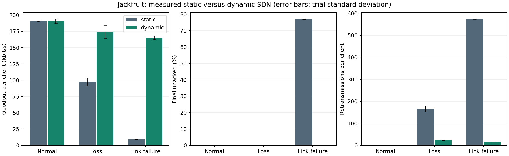

# Validation status

Validated on 1 November 2026 using real Mininet hosts, Open vSwitch datapaths,
OS-Ken, and UDP sockets inside a software-emulated Ubuntu guest used for validation.
The cloud host kernel could not run Mininet directly; the QEMU guest resolved
that limitation without changing the host kernel.

## Executed checks

- 17 automated socket, protocol, controller, memory-bound, notification, and
  reporting tests passed in the Ubuntu development container. No tests skipped.
- All 18 experiments passed: three trials × normal/loss/link failure ×
  static/dynamic. Each experiment used two clients and 400 packets per client.
- All normal runs retained the primary path with zero retransmissions.
- Every dynamic client delivered all packets in all scenarios.
- Static primary-link-failure runs correctly exhausted retry/deadline limits;
  these are expected negative experimental outcomes, not setup failures.
- The independent results audit verified authenticated application loss events,
  network failure events, backup forwarding rules in both directions, nonzero
  backup transit packet counters, queue drops, and receiver outcomes.

To reproduce on a supported Ubuntu 22.04 host or VM:

```sh
bash scripts/lab.sh build
bash scripts/lab.sh test
bash scripts/lab.sh matrix results/comparison
```

Guest environment: Ubuntu 22.04, Linux 5.15.0-202-generic, 2 virtual CPUs,
1536 MiB configured RAM, QEMU TCG software emulation, Python 3.10 and OS-Ken
2.6.0. Per-run environment details are included in the raw experiment metadata.

## Measured comparison

Means across three trials and two clients per trial:

| Scenario | Static goodput/client | Dynamic goodput/client | Static final unacked | Dynamic final unacked |
|---|---:|---:|---:|---:|
| Normal | 190.57 kbit/s | 190.64 kbit/s | 0% | 0% |
| 35% primary forward loss | 97.77 kbit/s | 174.24 kbit/s | 0% | 0% |
| Primary link failure | 9.42 kbit/s | 165.46 kbit/s | 77% | 0% |

For loss, mean retransmissions decreased from 165.83 to 23.50 per client.
Dynamic first-attempt ACK timeout ratio was 30.46% for packets first sent during
recovery and 0% for the 1481 packets first sent after rule completion. The
corresponding static during-impairment cohort had a 34.01% timeout ratio across
1911 packets. These are ACK-based indicators, not direct physical loss rates.

Mean fault-to-all-barriers time was 1.0393 seconds for application-triggered loss
recovery and 0.3936 seconds for link-failure recovery. See the methodology for
the distinction between controller completion and application recovery.



## Evidence and reproduction

- [Full measured report](results/REPORT.md)
- [Per-client metrics and before/during/after cohorts](results/summary.csv)
- [Complete raw logs, JSON, forwarding rules and queue counters](results/raw-mininet-runs.tar.gz)

To reproduce the audit, extract the raw archive to a fresh directory and run
`python3 scripts/verify_results.py <directory>`. To regenerate the report, run
`python3 -m jackfruit.analyze <directory>`.

Preliminary 150 ms timeout trials showed a false alarm under emulation and were
excluded. The final matrix used a conservative 500 ms timeout and an
eight-retransmission reporting threshold in both modes. No benchmark results
were invented. Netem randomness was not seeded; trial seeds control application
payload generation. Absolute throughput includes software-emulation and pacing
costs; compare policies within this environment rather than extrapolating to
hardware line rate. See [evaluation methodology](evaluation.md).
